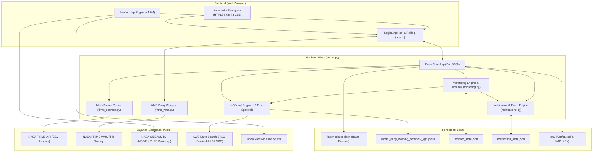
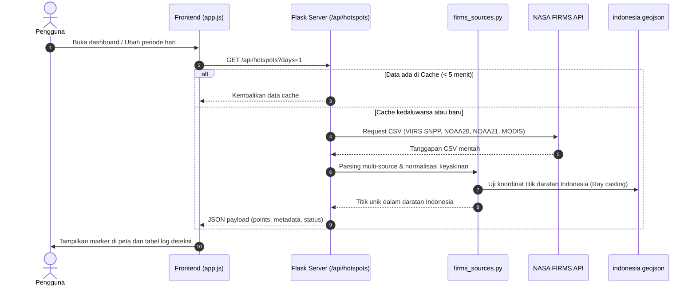
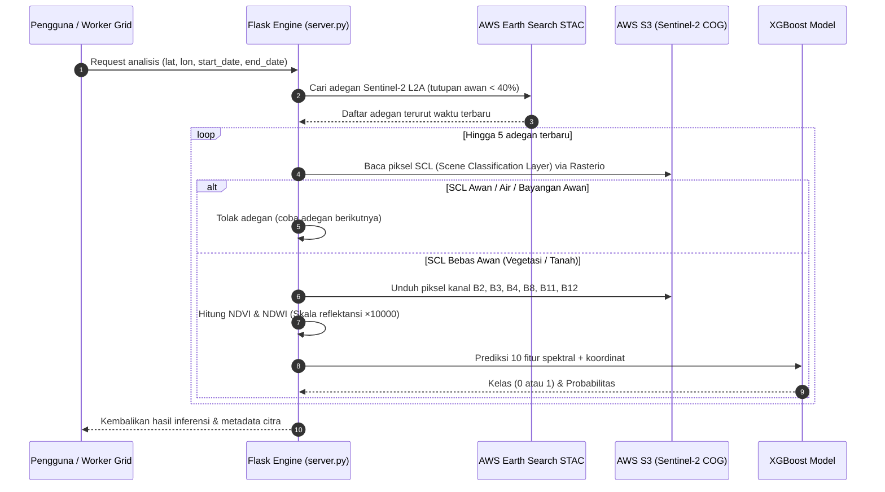
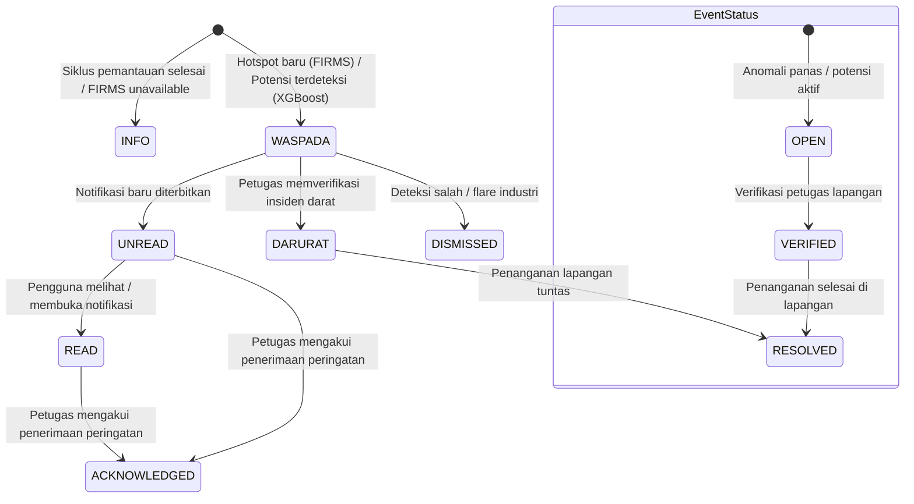

# Arsitektur & Alur Kerja Sistem (System Workflow)
## BARA / KARSA-FIRE — Indonesia Fire Watch

Dokumen ini menjelaskan arsitektur aktual, topologi komponen, dan alur pergerakan data pada aplikasi **BARA / KARSA-FIRE** yang berada di dalam folder `project_pkmm-master/`.

---

## 1. Topologi Arsitektur Aktual

Sistem dibangun dengan arsitektur *monolitik modular berbasis layanan mikro data*, menghubungkan antarmuka web interaktif dengan beberapa penyedia data geospatial publik global.

---

## 2. Alur Pengambilan & Pengolahan Data

### A. Alur Deteksi Anomali Panas NASA FIRMS (CSV)

Pengambilan data hotspot dilakukan secara berkala dan disimpan dalam cache memori server selama 5 menit (*TTL = 300 detik*).

### B. Alur WMS Proxy NASA FIRMS (Keamanan Kredensial)

Untuk melindungi kredensial `FIRMS_MAP_KEY` agar tidak terlihat oleh publik di peramban pengguna (*network inspector*), sistem menyediakan proxy terbalik (*reverse proxy*):

1. Frontend memanggil endpoint internal:  
   `/api/firms/wms?SERVICE=WMS&REQUEST=GetMap&LAYERS=fires_viirs_24&BBOX=...`
2. `firms_wms.py` memvalidasi nama layer ke dalam daftar putih (*whitelist* 8 layer resmi).
3. Backend menyisipkan `FIRMS_MAP_KEY` ke dalam path upstream NASA:  
   `https://firms.modaps.eosdis.nasa.gov/mapserver/wms/fires/{MAP_KEY}/`
4. Backend mengambil citra PNG dari NASA dan mengalirkannya ke Leaflet tanpa membocorkan key atau header sensitif.

---

## 3. Alur Analisis Sentinel-2 & XGBoost

Inferensi kerawanan vegetasi dilakukan langsung pada kanal reflektansi spektral permukaan bumi:

---

## 4. Alur Pemantauan Grid Otomatis (Background Worker)

Pemantauan grid otomatis berjalan pada thread terpisah (*background worker thread*) di server:

1. **Konfigurasi:** Pengguna memilih area (2 sudut diagonal) di peta dan menentukan interval waktu (30, 60, atau 180 menit).
2. **Generasi Titik:** Titik-titik sampel 3 × 3 dibuat di dalam bounding box dan difilter hanya yang berada di daratan Indonesia.
3. **Siklus Eksekusi:**
   - Worker mengambil maksimal 5 titik per siklus secara *round-robin*.
   - Setiap titik diproses satu per satu melalui pipeline STAC + Rasterio + XGBoost.
   - Hasil disimpan secara atomik ke dalam berkas `monitor_state.json`.
4. **Pemicu Notifikasi:**
   - Jika suatu titik terdeteksi sebagai **Kelas 1 (berpotensi terbakar)**, worker memicu sinyal ke `NotificationEngine`.
   - Sebuah notifikasi berstatus `WASPADA` otomatis dibuat dan dicatat dalam riwayat event.
5. **Daya Tahan Sistem:**
   - Jika server mati atau direstart, status terakhir dibaca kembali dari `monitor_state.json`.
   - Titik yang sebelumnya terhenti pada status `running` direset kembali ke `pending` agar tidak ada sampel yang terabaikan.

---

## 5. Alur Siklus Hidup Notifikasi & Event

Pusat notifikasi menerapkan tata kelola insiden yang ketat demi menjaga integritas data:

> [!NOTE]
> **Aturan Khusus DARURAT:**  
> Sistem otomatis tidak diizinkan menciptakan status `DARURAT`. Status `DARURAT` hanya dapat diaktifkan oleh tindakan manusia (petugas) melalui antarmuka resmi dengan memasukkan identitas verifikator.

